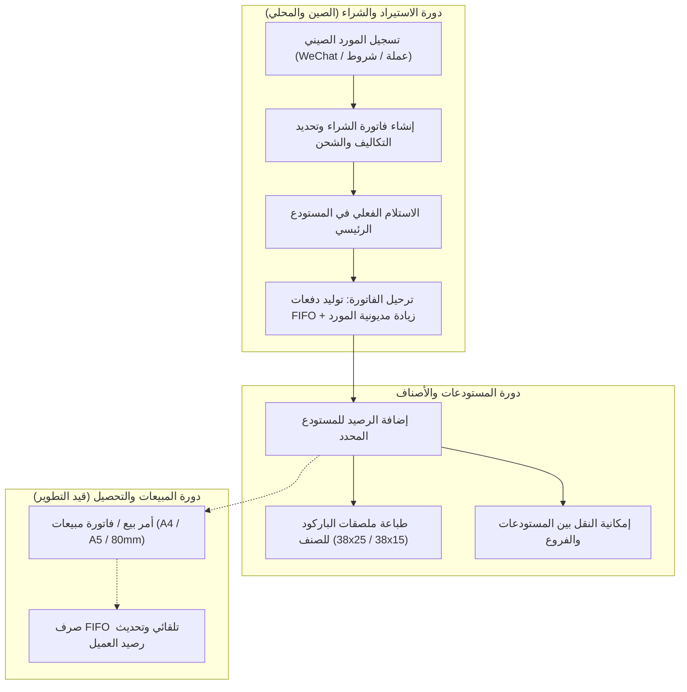

# تقرير التدقيق الشامل لتجربة المستخدم، والوظائف التشغيلية، والمنطق المحاسبي والتجاري
## BayoSoft ERP (Kayan ERP) — Comprehensive UX, Functional & Business Logic Audit

> **تاريخ التدقيق:** 14 أكتوبر 2026  
> **فريق التدقيق الاستشاري:**
> 1. **صاحب عمل تجاري ومستورد:** تاجر جملة يستورد إكسسوارات حريمي وتوك شعر وبضائع تجارية من الصين ومحلياً.
> 2. **رئيس الحسابات (Accountant):** مسؤول المشتريات، التكاليف، المخازن، والذمم الدائنة والمدينة.
> 3. **الكاشير والمبيعات (Cashier):** مسؤول إصدار الفواتير، التحصيل، وطباعة الإيصالات والملصقات.
> 4. **مدير المستودعات (Warehouse Manager):** مسؤول الاستلام، الصرف، التحويل بين الفروع، والتسويات.
> 5. **مهندس ضبط الجودة والـ QA:** تتبع واختبار كل زر، استمارة، مسار، وقاعدة بيانات من البداية للنهاية.

---

## 1. ملخص تنفيذي وتقييم الجاهزية التشغيلية (Executive Summary)

تم فحص ومراجعة كافة مكونات المشروع: المسارات (`routes/web.php`)، المتحكمات (`Controllers`)، النماذج (`Models`)، التهجيرات (`Migrations`)، الخدمات (`Services`)، قوالب العرض (`Blade`)، وملفات التفاعل (`JavaScript` و `CSS`).

### النتيجة العامة للتدقيق:
- **المعمارية الأساسية للبيانات والمخزون (FIFO) متينة وممتازة برمجياً.**
- **تم اكتشاف عيوب تشغيلية حرجة (Critical UI Bugs) تُعطل أزرار الإضافة والطباعة الرئيسية** في صفحات العملاء والموردين ومكاتب الشحن والمنتجات نتيجة خطأ برمجي موحد في نطاق استدعاء مستمعي الأحداث (`page.querySelectorAll` بدلاً من `document.querySelectorAll` للعناصر الموجودة في ترويسة الصفحة `x-control-panel`).
- **المورد الصيني يعامل حالياً بنفس حقول المورد المحلي**، مما يُفقد المستورد بيانات أساسية (معرف WeChat، شروط الدفع والتعاقد، العملة المتفق عليها، ميناء الشحن، وملاحظات التخليص).
- **فاتورة الشراء عند ترحيلها تولد دفعات المخزون بدقة، ولكنها لا تزيد رصيد مديونية المورد تلقائياً** في جدول الموردين (`suppliers.current_balance`).
- **أزرار طباعة الفواتير تطبع صفحة الويب الإدارية الخام (`window.print()`)** بدلاً من استدعاء قوالب الطباعة المصممة بدقة (A4, A5, 80mm).

---

## 2. مصفوفة تدقيق الوظائف (Functional Audit Matrix)

### أولاً: الوظائف المكتملة وتعمل بنجاح (Fully Operational Functions)
1. **محرك تسعير المنتجات متعدد المستويات:** (سعر القطاعي، سعر الجملة، وسعر الموزع) مع التحقق من عدم قبول أرقام سالبة.
2. **الرصيد الافتتاحي للأصناف (Opening Stock):** توليد دفعة أولى وتوليد حركة افتتاحية فريدة مع تحديد التكلفة والمستودع الافتراضي تلقائياً.
3. **محرك تتبع المخزون الوارد أولاً يصرف أولاً (FIFO Inventory Engine):** في `InventoryService`، حساب تكلفة المنصرف بدقة وتحديث الرصيد التراكمي `running_balance`.
4. **حركات المخزون اليدوية الأربعة:** (إضافة وارد، صرف مخزني، تحويل بين مستودعين، وتسوية جردية) عبر `inventory/movements`.
5. **توليد باركودات المنتجات بطباعة ملصقات الـ SVG:** مع دعم ملصقات (38×25 مم و 38×15 مم) وخلو كامل من الانهيارات.
6. **مركز قوالب الطباعة المرئي (Print Template Center):**
   - يدعم المستندات الـ 4 والمقاسات الـ 3 (A4, A5, Thermal 80mm) بإجمالي 12 قالباً افتراضياً.
   - حفظ وتطهير الإعدادات (Sanitized JSON) مع واجهة معاينة تفاعلية فورية بدون إعادة تحميل.
7. **استيراد المنتجات من إكسيل (Excel Import):** تدقيق ملف الإكسيل ومراجعته وتأكيده مع الفئات.
8. **فصل الواجهة والأمان (Blade Separation):** 30 ملف Blade متوافقة بنسبة 100% مع معايير منع الأكواد المضمنة.

---

### ثانياً: وظائف قائمة ولكنها معطلة أو بها خلل (Broken / Partially Broken Functions)

| الوظيفة / الزر | الصفحة | سبب الخلل الفعلي (Root Cause) | الأثر التشغيلي |
| :--- | :--- | :--- | :--- |
| **زر "إضافة عميل جديد"** | `/customers` | في `customers.js` السطر 68: استخدام `page.querySelectorAll('[data-action="open-add-customer"]')`. الزر موجود داخل `x-control-panel` خارج وسم `[data-page="customers"]`، فلا يربط الكود أي حدث نقر! | الزر ميت تماماً ولا يفتح نافذة الإضافة. |
| **زر "إضافة مورد جديد"** | `/suppliers` | في `suppliers.js` السطر 69: استخدام `page.querySelectorAll('[data-action="open-add-supplier"]')` بدلاً من `document`. | الزر ميت ولا يستجيب للنقر إطلاقاً. |
| **زر "إضافة مكتب شحن"** | `/shipping-offices` | في `shipping-offices.js` السطر 65: استخدام `page.querySelectorAll('[data-action="open-add-shipping"]')`. | الزر ميت في أعلى الصفحة. |
| **زر "طباعة ملصقات الأصناف المحددة"** | `/products` (الترويسة) | في `products-index.js` السطر 15: `const topBatchBtn = page.querySelector('#topBatchPrintBtn')`. الزر في شريط التحكم الخارجي، فتكون القيمة `null` ولا يظهر الزر أبداً عند تحديد المربعات. | حرمان المستخدم من طباعة دفعات الملصقات من الترويسة. |
| **زر "طباعة الفاتورة"** | `/purchases/{id}` | الزر يستدعي `window.print()` مباشرة، فيطبع واجهة المتصفح والقوائم والـ Sidebar، ولا يوجه المستخدم لقالب الفاتورة الرسمي (A4 / A5 / 80mm). | طباعة غير صالحة للمستندات التجارية. |
| **حفظ التعديلات في النوافذ المنبثقة** | العملاء والموردين | غياب حماية منع النقر المزدوج (`debounce` أو `disabled on submit`)، مما يسبب إرسال طلبين متتاليين وتكرار السجلات عند بطء الشبكة. | تكرار بيانات العملاء والموردين في قاعدة البيانات. |

---

### ثالثاً: وظائف مفقودة في الواجهة الخلفية أو دورة العمل (Missing Backend Implementation)

1. **دورة المبيعات الرسمية والفوترة (Sales Invoices Module):**
   - لا يوجد جدول `sales_invoices` أو `sales_invoice_items`.
   - قوالب الطباعة تدعم فواتير المبيعات ببيانات تجريبية ممتازة، ولكن النظام لا يحتوي بعد على شاشة إصدار فواتير بيع أو خصم مبيعات من المخزون (مجدولة للمرحلة 8).
2. **ترحيل فواتير الشراء إلى حسابات الموردين المالية (Purchasing Payable Posting):**
   - عند الضغط على "ترحيل الفاتورة" في `PurchaseInvoiceController@post`، يتم ترحيل البضاعة إلى المخزن، **لكن رصيد المورد `suppliers.current_balance` لا يتأثر ولا يزداد بمبلغ الفاتورة!**
3. **سندات الصرف والقبض (Payment & Receipt Vouchers):**
   - لا توجد دورة تسجيل لسداد دفعات الموردين أو تحصيل أموال من العملاء، مما يجعل كشف الحساب غير قادر على رصد المدفوعات النقدية والبنكية الفعلية.
4. **شاشة جرد المخزون الدوري (Physical Stocktaking):**
   - توجد حركات تسوية فردية، ولكن لا توجد دورة جرد شاملة للمستودع (مقارنة الجرد الفعلي بالرصيد الدفتري واستخراج الفروقات واعتمادها).

---

## 3. تدقيق المنطق التشغيلي من منظور أدوار فريق العمل

### أ. منظور تاجر الجملة والمستورد من الصين (Business Owner):
- **المشكلة:** عند التعامل مع مصانع في "إيوو" (Yiwu) أو "كوانزو" (Guangzhou)، لا يتم التعامل بالجنيه المصري ولا بالهاتف العادي فقط؛ التعامل الأساسي يتم عبر **WeChat ID**، وعملات **اليوان الصيني (CNY)** أو **الدولار (USD)**، وبشروط دفع محددة (مثل: 30% دفعة مقدمة و 70% مقابل بوليصة الشحن).
- **المطلوب فوراً:** جعل استمارة المورد ذكية وديناميكية: اختيار "مورد محلي (مصر)" يُظهر السجل التجاري والبطاقة الضريبية والعنوان المحلي؛ بينما اختيار "مصنع / مورد بالصين أو دولي" يُظهر حقول الدولة، المدينة، معرف ويشات (WeChat ID)، عملة الفاتورة، شروط السداد، وميناء ومكتب الشحن.

### ب. منظور رئيس الحسابات (Accountant):
- **المشكلة:** فصل المخزون عن الذمم؛ عند استلام بضاعة بقيمة 200,000 ج.م من مورد، تدخل البضاعة المخزن بالتكلفة الصحيحة، لكن كشف حساب المورد يظل صفراً لأنه لم يتم قيد الاستحقاق المالي على حسابه!
- **الحل:** ربط ميثاق الترحيل `executePosting` في `PurchaseInvoiceController` بتحديث فوري لرصيد المورد `Supplier::where('id', $supplier_id)->increment('current_balance', $totalAmount)`.

### ج. منظور الكاشير ومسؤول الطباعة (Cashier):
- **المشكلة:** عند طلب طباعة فاتورة شراء أو حركة بضاعة، تنفتح نافذة المتصفح لطباعة الصفحة الكاملة بشريطها العلوي وقوائمها الجانبية.
- **الحل:** توجيه زر الطباعة إلى مسار طباعة مخصص يستدعي قالب الطباعة المعتمد من مركز القوالب (وفق المقاس المطلوب: A4 أو A5 أو 80mm حراري) بدون عناصر واجهة الموقع (`no-print`).

### د. منظور مدير المستودعات (Warehouse Manager):
- **المشكلة:** زر طباعة ملصقات الباركود المجمعة من جدول المنتجات لا يستجيب في الترويسة، ويضطر المدير لفتح كل صنف على حدة لطباعة ملصقه.
- **الحل:** تصحيح ربط زر `#topBatchPrintBtn` ليعمل بمجرد تحديد مربعات الاختيار في الجدول.

### هـ. منظور مهندس الجودة (QA Engineer):
- تم رصد العيوب بدقة؛ وتحديد أن جميع أزرار الإضافة في الترويسة العلوية لصفحات (العملاء، الموردين، مكاتب الشحن) تعاني من نفس الخطأ الهيكلي في الـ JavaScript (`event listener scope`).

---

## 4. خطة الإصلاحات الهندسية المرتبة حسب الأولوية (Remediation Plan)

### المرحلة الأولى: الإصلاحات الفورية للأزرار المعطلة (Priority 1 — Critical Fixes)
1. **تصحيح نطاق استدعاء أزرار الإضافة (Add Buttons Fix):**
   - تعديل `resources/js/pages/customers.js` للبحث في `document` عن `[data-action="open-add-customer"]`.
   - تعديل `resources/js/pages/suppliers.js` للبحث في `document` عن `[data-action="open-add-supplier"]`.
   - تعديل `resources/js/pages/shipping-offices.js` للبحث في `document` عن `[data-action="open-add-shipping"]`.
   - إضافة ميزة منع التكرار (Double Click / Submit Prevention) وتعطيل الزر أثناء الإرسال.
2. **تصحيح زر طباعة الدفعات في المنتجات (Batch Print Button Fix):**
   - تعديل `resources/js/pages/products-index.js` للوصول إلى `#topBatchPrintBtn` و `#topBatchCount` عبر `document` وإظهارهما وتحديثهما فور تحديد الأصناف.
3. **تفعيل دورة طباعة فواتير الشراء الحقيقية (Purchase Invoice Print Integration):**
   - ربط زر الطباعة في `purchases/show.blade.php` ليفتح مستند الطباعة المخصص النظيف المتوافق مع قوالب A4 و A5 و 80mm حراري.

### المرحلة الثانية: تطوير استمارة المورد الصيني والمحلي وقاعدة البيانات (Priority 2 — Chinese Supplier Upgrade)
1. **إنشاء تهجير آمن وغير مدمر:**
   - إضافة أعمدة إلى جدول `suppliers`:
     - `wechat_number` (string nullable - رقم الهاتف المرتبط بـ ويشات)
     - `tax_number` (string nullable - البطاقة الضريبية للمورد المحلي)
     - `commercial_registry` (string nullable - السجل التجاري)
     - `payment_terms` (string nullable - شروط الدفع، مثلاً: 30% دفعة مقدمة والباقي قبل الشحن)
     - `shipping_port` (string nullable - ميناء التحميل / الشحن مثل Ningbo أو Shanghai)
2. **الواجهة التفاعلية (Dynamic Conditional UI):**
   - عند اختيار نوع المورد `china_factory` (مصنع بالصين) أو دولة أخرى غير مصر: إظهار حقول WeChat، العملة (CNY / USD)، شروط السداد، وميناء الشحن.
   - عند اختيار `local_supplier` (مورد محلي): إظهار حقول السجل التجاري والبطاقة الضريبية والجنيه المصري (EGP).
3. **التحقق البرمجي (Backend Validation):**
   - تحديث `SupplierController@store` و `SupplierController@update` للتحقق الدقيق من هذه المدخلات مع رسائل خطأ واضحة باللغة العربية.

### المرحلة الثالثة: ضبط المنطق المحاسبي لفواتير الشراء والذمم (Priority 3 — Accounting Link)
- تعديل ميثاق ترحيل الفاتورة في `PurchaseInvoiceController`: عند ترحيل الفاتورة، يتم زيادة رصيد المورد الدائن `current_balance` تلقائياً بمبلغ إجمالي الفاتورة، لضمان دقة كشوف الحسابات.

---

> [!IMPORTANT]
> **التوقف للمراجعة والاعتماد:**  
> وفقاً للتعليمات المشددة، تم إيقاف العمل بعد إنجاز التدقيق الكامل وإعداد التقرير، وبانتظار موافقتكم الكريمة للشروع فوراً في تنفيذ **المرحلة الأولى من الإصلاحات (أزرار الإضافة والطباعة)** ثم **تطوير استمارة المورد الصيني**.
