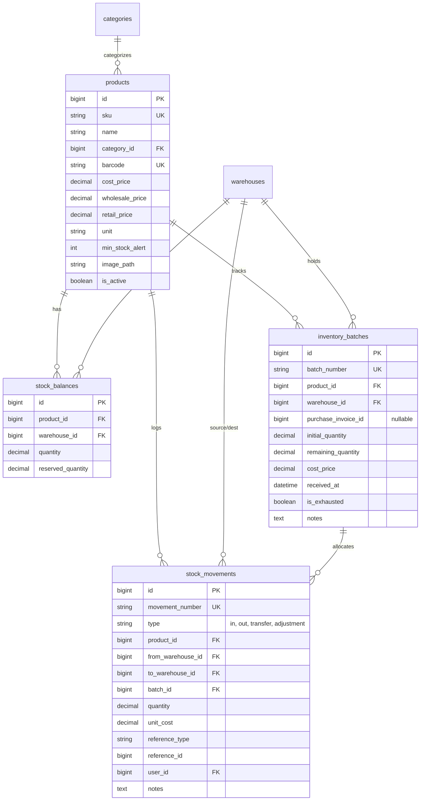
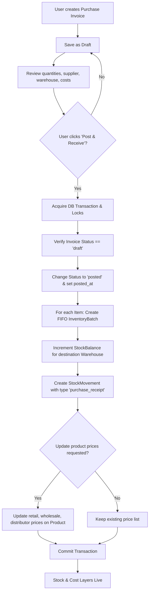

# Kayan ERP / BayoSoft — Comprehensive Feature Audit, Risk Assessment & Architecture Plan

**Date:** 2026-10-14  
**Audit Mode:** READ-ONLY Architectural Audit & Risk Assessment  
**Repository:** `kayan-erp-new` (Laravel 13, PHP 8.4, MySQL 8.0, Vite 8, Tailwind CSS v4)  
**Database:** Active connection verified to `kayan_erp` (Legacy `kayan` database isolated and untouched).  

---

## 1. Executive Summary & Verification of Existing Features

Following the directive to conduct a read-only audit before any implementation, this report details the factual state of the application code, database schema, inventory costing, purchasing pipeline, user-reported UI defects, and the commercial branding strategy for **BayoSoft**.

### A. What Currently Exists and is Verified:
1. **Product Management (`app/Models/Product.php`, `ProductController.php`):**
   - Products CRUD with categories, barcode lookup, indexed search (SKU, name, barcode).
   - Existing pricing fields: `cost_price` (تكلفة), `wholesale_price` (جملة), `retail_price` (قطاعي).
   - **Missing:** Distributor price (`distributor_price` / موزع) does **NOT** exist in schema or models.
   - **Missing:** Pieces per package / unit (`pieces_per_package`) does **NOT** exist.
   - **Missing:** Opening balance fields in product creation form do **NOT** exist.
2. **Multi-Warehouse Foundations (`Warehouse.php`, `StockBalance.php`, `StockMovement.php`, `InventoryBatch.php`):**
   - Table `warehouses` exists with active/default indicators.
   - Table `stock_balances` tracks product-warehouse quantities with `quantity` and `reserved_quantity`.
   - Table `inventory_batches` exists with FIFO batch tracking (`received_at`, `cost_price`, `remaining_quantity`, `is_exhausted`).
   - Table `stock_movements` exists with types `in`, `out`, `transfer`, `adjustment`.
3. **Directory Modules (Phase 6):**
   - `customers` (عملاء الجملة): credit limits, pricing tier (جملة / قطاعي / خاص).
   - `suppliers` (الموردون ومصانع الصين): currencies (RMB, USD, EGP), WeChat ID, WhatsApp.
   - `shipping_offices` (مكاتب الشحن والتخليص الجمركي): shipping lines, tracking.
4. **Excel Import & Verification (`ProductImportService.php`, `ProductImportController.php`):**
   - Pre-import validation, new/update classification, atomic commit.
5. **Automated Testing Suite:**
   - **80 passed tests, 409 assertions (100% passing)** across unit, feature, and architecture tests.

### B. What is Incomplete or Missing:
1. **Purchasing & Invoicing Pipeline:** Completely unbuilt (no `purchase_invoices` table, no controller, no views).
2. **Opening Balance on Product Creation:** Missing from `products.create` form and controller.
3. **Distributor Price Tier (`distributor_price`):** Not present in database or UI.
4. **Dedicated Product Movement Ledger (كشف حركة الصنف التفصيلي):** Only a generic movement log exists; running balance per movement is not tracked in the schema.

---

## 2. Current Database Schema vs. Proposed Schema

### A. Current Relevant Schema


### B. Proposed Schema Extensions
To support Distributor Price, Opening Balance, Purchasing Invoices, and Running Ledger Balances:

1. **`products` Table Migration:**
   - Add `distributor_price` (`decimal(12,2) unsigned DEFAULT 0.00 AFTER retail_price`).
   - Add `pieces_per_package` (`int unsigned NULL AFTER unit`).
   - Add `opening_cost` (`decimal(12,2) unsigned NULL AFTER cost_price`).
   - Add `opening_quantity` (`decimal(12,2) DEFAULT 0.00`).
   - Add `opening_balance_date` (`date NULL`).

2. **`purchase_invoices` Table (New):**
   ```sql
   CREATE TABLE purchase_invoices (
       id BIGINT UNSIGNED AUTO_INCREMENT PRIMARY KEY,
       invoice_number VARCHAR(80) NOT NULL UNIQUE,
       supplier_id BIGINT UNSIGNED NOT NULL,
       warehouse_id BIGINT UNSIGNED NOT NULL,
       invoice_date DATE NOT NULL,
       supplier_invoice_reference VARCHAR(100) NULL,
       currency VARCHAR(10) DEFAULT 'EGP',
       exchange_rate DECIMAL(10,4) DEFAULT 1.0000,
       subtotal DECIMAL(14,2) DEFAULT 0.00,
       shipping_cost DECIMAL(12,2) DEFAULT 0.00,
       customs_cost DECIMAL(12,2) DEFAULT 0.00,
       total_amount DECIMAL(14,2) DEFAULT 0.00,
       paid_amount DECIMAL(14,2) DEFAULT 0.00,
       status ENUM('draft', 'posted', 'cancelled') DEFAULT 'draft',
       posted_at DATETIME NULL,
       created_by BIGINT UNSIGNED NOT NULL,
       notes TEXT NULL,
       created_at TIMESTAMP NULL,
       updated_at TIMESTAMP NULL,
       FOREIGN KEY (supplier_id) REFERENCES suppliers(id) ON DELETE RESTRICT,
       FOREIGN KEY (warehouse_id) REFERENCES warehouses(id) ON DELETE RESTRICT,
       FOREIGN KEY (created_by) REFERENCES users(id) ON DELETE RESTRICT
   );
   ```

3. **`purchase_invoice_items` Table (New):**
   ```sql
   CREATE TABLE purchase_invoice_items (
       id BIGINT UNSIGNED AUTO_INCREMENT PRIMARY KEY,
       purchase_invoice_id BIGINT UNSIGNED NOT NULL,
       product_id BIGINT UNSIGNED NOT NULL,
       quantity DECIMAL(12,2) NOT NULL,
       unit_cost DECIMAL(12,2) NOT NULL,
       subtotal DECIMAL(14,2) NOT NULL,
       update_selling_prices BOOLEAN DEFAULT FALSE,
       new_retail_price DECIMAL(12,2) NULL,
       new_wholesale_price DECIMAL(12,2) NULL,
       new_distributor_price DECIMAL(12,2) NULL,
       batch_id BIGINT UNSIGNED NULL,
       created_at TIMESTAMP NULL,
       updated_at TIMESTAMP NULL,
       FOREIGN KEY (purchase_invoice_id) REFERENCES purchase_invoices(id) ON DELETE CASCADE,
       FOREIGN KEY (product_id) REFERENCES products(id) ON DELETE RESTRICT,
       FOREIGN KEY (batch_id) REFERENCES inventory_batches(id) ON DELETE SET NULL
   );
   ```

4. **`stock_movements` Table Enhancements:**
   - Add `running_balance` (`decimal(14,2) NULL`) to record the exact warehouse balance immediately after the transaction.
   - Add `customer_id` (`bigint unsigned NULL REFERENCES customers(id)`).
   - Add `supplier_id` (`bigint unsigned NULL REFERENCES suppliers(id)`).
   - Extend `type` enum/string to include:
     - `opening_balance` (رصيد أول المدة)
     - `purchase_receipt` (استلام مشتريات)
     - `sales_issue` (صرف مبيعات)
     - `transfer` (تحويل بين المخازن)
     - `purchase_return` (مرتجع مشتريات)
     - `sales_return` (مرتجع مبيعات)
     - `adjustment` (تسوية جردية)

---

## 3. Product Opening Balance: Accounting & Inventory Rules

### Fundamental Principle: An Opening Balance is NOT a Purchase Invoice
1. **Initial Creation Only:**
   - Opening balance inputs (`opening_quantity`, `opening_cost`, `warehouse_id`, `opening_date`) are exposed on `products.create`.
   - On `products.edit`, these opening balance fields are **locked / read-only**. Editing an existing product's name, category, or prices must **never** re-trigger an opening stock movement.
2. **Atomic Execution upon Product Creation:**
   - If `opening_quantity > 0`:
     - Creates an initial `InventoryBatch` with `cost_price = opening_cost`, `received_at = opening_date`, `notes = 'رصيد أول المدة عند تأسيس الصنف'`.
     - Increments `stock_balances` for the specified warehouse.
     - Logs an auditable `StockMovement` with `type = 'opening_balance'`, `reference_type = 'opening_balance'`, `reference_id = $product->id`.
3. **Guard Against Zero / Negative Cost & Quantities:**
   - `opening_quantity` must be `>= 0`.
   - `opening_cost` must be `>= 0` (if quantity > 0, unit cost is required).
   - Total opening inventory valuation = `opening_quantity * opening_cost`.
4. **Corrections After Posting:**
   - Once posted, any discrepancies must be handled via formal **Stock Adjustment (تسوية جردية)** or administrative reconciliation, never by silent overwriting.

---

## 4. Purchasing, Receiving, and FIFO Costing Architecture

### A. Workflow: Draft vs. Posted


### B. FIFO Per-Warehouse vs. Shared Pool (Architectural Recommendation)
* **Recommendation: Strict Per-Warehouse FIFO.**
  * In commercial retail/wholesale with multiple branches (e.g., Cairo Main Warehouse vs. Mosky Retail Branch), shipments arrive at specific warehouses with specific landed costs (customs, freight).
  * Consuming goods from Branch A must consume Branch A's cost layers.
  * When goods transfer from Warehouse A to Warehouse B, the transfer consumes the oldest layer in A and creates an incoming layer in B at that exact historical cost.
  * This prevents artificial profit distortions between branches.

### C. Concurrency & Integrity Controls
- Both `StockBalance` and `InventoryBatch` queries for deductions must use `lockForUpdate()` within an active `DB::transaction`.
- Deductions check that `remaining_quantity >= requested_quantity` before saving.
- Partial batch consumption splits movements into discrete lines linking directly to the consumed `batch_id`.

---

## 5. Dedicated Product Movement Ledger (كشف حركة الصنف التفصيلي)

The ledger must be easily accessible from `products.show` via a dedicated tab / drawer or separate route `GET /products/{product}/ledger`.

### Recommended RTL Arabic Columns:
| # | التاريخ والوقت | رقم الحركة / المستند | نوع الحركة | من مخزن | إلى مخزن | العميل / المورد | الوارد | المنصرف | الرصيد بعد الحركة | تكلفة الوحدة | إجمالي القيمة | المستخدم | الحالة |
| :---: | :---: | :---: | :---: | :---: | :---: | :---: | :---: | :---: | :---: | :---: | :---: | :---: | :---: |

### Movement Type Badges:
- **رصيد أول المدة** (`opening_balance`): أزرق ملكي
- **استلام مشتريات** (`purchase_receipt`): أخضر
- **صرف مبيعات** (`sales_issue`): أحمر
- **تحويل مخزني** (`transfer`): بنفسجي
- **مرتجع مشتريات** (`purchase_return`): برتقالي
- **مرتجع مبيعات** (`sales_return`): أصفر
- **تسوية جردية** (`adjustment`): رمادي داكن

---

## 6. Root Cause Analysis of Confirmed UI Issues (Part F)

### Issue 1: Barcode Preview `38 × 15 mm` Button Malfunction
* **Location:** `resources/views/settings/index.blade.php`, `resources/js/pages/settings.js`.
* **Root Causes Identified:**
  1. **Height Clamping Bug in JS:** In `settings.js` line 101:
     ```javascript
     const frameHeightPx = Math.round((heightMm / widthMm) * frameWidthPx);
     frame.style.height = Math.max(120, frameHeightPx) + 'px';
     ```
     For a `38×15 mm` label with `frameWidthPx = 240`, the calculated height is `(15/38) * 240 = 94.7 px`. However, `Math.max(120, 94.7)` clamps it to `120px`! The frame therefore fails to shrink to the compact 15mm ratio.
  2. **Static Barcode SVG Height:** `<svg id="previewBarcodeSvg" height="35">` in `settings/index.blade.php` has a hardcoded SVG height. When the preset sets `data-bar-h="40"`, the preview SVG is never scaled or updated.
* **Proposed Fix:** Remove the `120px` artificial floor in `settings.js` (allow `frameHeightPx` down to `80px`), dynamically update `previewBarcodeSvg` height attribute to match `inputBarcodeH.value`, and add active visual state to the clicked preset button.

### Issue 2: Missing Site/Favicon Icon Next to Page Title
* **Location:** `public/favicon.ico`, `resources/views/layouts/app.blade.php`.
* **Root Causes Identified:**
  1. **Empty Favicon Asset:** `public/favicon.ico` in the repository has a file size of **0 bytes**! When desktop browsers (Chrome, Edge) automatically request `/favicon.ico`, the web server returns an empty file, causing the tab to display a blank or broken icon.
  2. **Unreliable SVG Data URI:** `layouts/app.blade.php` falls back to an inline SVG data URI `<link rel="icon" href="data:image/svg+xml,...">` without `type="image/svg+xml"`. On several Windows browser engines, the presence of an empty root `favicon.ico` overrides inline data URIs.
* **Proposed Fix:** Generate a clean, crisp branded `.ico` and local SVG icon (`public/favicon.ico` and `public/favicon.svg`), link both with standard `type` attributes in `layouts/app.blade.php`, and ensure proper fallback when no custom company logo is uploaded.

### Issue 3: "تسجيل حركة مخزون جديدة" Button Unresponsive
* **Location:** `resources/views/inventory/index.blade.php` & `resources/js/pages/inventory.js`.
* **Root Cause Identified (Scope Mismatch Bug):**
  - In `inventory/index.blade.php`, the button:
    ```blade
    <button type="button" data-action="open-movement-modal" class="erp-btn erp-btn-primary">
        <span>تسجيل حركة مخزون جديدة</span>
    </button>
    ```
    is defined inside `@section('control_panel')`.
  - In `resources/js/pages/inventory.js`:
    ```javascript
    const page = document.querySelector('[data-page="inventory"]');
    const openModalBtns = page.querySelectorAll('[data-action="open-movement-modal"]');
    ```
  - `<div data-page="inventory">` is rendered inside `@section('content')`, which is **outside and below** the `@section('control_panel')` rendered by `layouts/app.blade.php`.
  - Therefore, `page.querySelectorAll(...)` searches **only inside the content div** and returns **0 elements**! The click listener is **never attached** to the header button, rendering it completely dead.
* **Proposed Fix:** Update the selector in `inventory.js` to `document.querySelectorAll('[data-action="open-movement-modal"]')` (and likewise for `open-add-warehouse` in `warehouses.js`), ensuring listeners attach regardless of whether the button lives in the control panel header or the body.

---

## 7. BayoSoft Commercial Branding Risk Assessment (Part G)

The user intends to commercialize this ERP under the brand **BayoSoft**.

### A. Full Codebase Branding Audit
| Classification Category | Current Occurrences in Codebase | Risk of Global Replacement | Recommendation |
| :--- | :--- | :---: | :--- |
| **1. Customer-Facing UI** | `<title>... | Kayan ERP</title>`, Topbar logo text (`Kayan ERP`), App launcher header (`تطبيقات Kayan ERP`), Print titles, Breadcrumbs. | **Low Risk** | Replace with **BayoSoft** (or `BayoSoft ERP` / `بايوسوفت`). |
| **2. Configurable Company Name** | `CompanySetting::$company_name` (default: "Kayan Fashion Accessories" / "شركة كيان للتجارة والتوزيع"). | **Zero Risk** | Keep fully dynamic so the business buyer can put their own company name on invoices and thermal labels. |
| **3. Database Names & Connections** | `.env` (`DB_DATABASE=kayan_erp`), migration scripts, test setups (`kayan_erp`). | **CRITICAL RISK** | **DO NOT RENAME DATABASE**. Renaming to `bayosoft_erp` risks breaking existing MySQL permissions, backups, local MySQL tables, and historical desktop references. Keep `DB_DATABASE=kayan_erp`. |
| **4. Internal Code Identifiers** | PHP namespaces (`App\...`), variable names, helper IDs (`kayanBarcodeScannerModal`, `kayanThemeToggle`). | **High Risk** | Keep internal IDs stable or refactor only UI-facing DOM IDs. Changing PHP namespaces would break class autoloading and cache. |
| **5. Composer & NPM Metadata** | `composer.json` (`laravel/laravel`), `package.json`. | **Zero Risk** | Safe to update package description or vendor if desired. |
| **6. Automated Tests** | `tests/Feature/ExampleTest.php` (`assertSee('Kayan ERP')`), `ProductImportTest.php`. | **Medium Risk** | Tests must be updated concurrently with UI strings to prevent test suite failures. |
| **7. Repository & Git** | Remote URL (`MRagabBayoumi/kayan-erp-new.git`), directory `kayan-erp-new`. | **Medium Risk** | Renaming Git remote breaks existing clones unless remotes are re-linked. Keep repository name as-is. |

### B. Phased, Reversible Branding Implementation Plan:
1. **Phase 1 (Safe Customer-Facing Branding):**
   - Update `config/app.php` and `APP_NAME` in `.env.example` to `BayoSoft ERP`.
   - Update `layouts/app.blade.php` title and topbar to render `config('app.name', 'BayoSoft ERP')`.
   - Update `app-launcher.blade.php` and `control-panel.blade.php`.
   - Install local `BayoSoft` favicon icon in `public/favicon.ico` and SVG.
   - Update Pest assertions in `ExampleTest.php` to assert `BayoSoft ERP`.
2. **Phase 2 (Company Name Independence):**
   - Retain `CompanySetting` table so the subscriber/tenant can name their company (e.g. "مؤسسة فلان للتجارة") while the system software is powered by **BayoSoft**.

---

## 8. Safe Migration Sequence & Rollback Plan

### Step-by-Step Implementation Sequence:
1. **Fix UI Bugs First (Non-Breaking, Immediate Value):**
   - Fix `open-movement-modal` selector in `resources/js/pages/inventory.js`.
   - Fix `apply-barcode-preset` clamping and SVG height in `resources/js/pages/settings.js`.
   - Generate valid `public/favicon.ico` and `public/favicon.svg` and update `layouts/app.blade.php`.
   - Recompile assets (`npm run build`) and verify.
2. **Database Migration for Product Schema Extensions:**
   - Create migration `add_distributor_price_and_opening_stock_to_products_table`:
     - Adds `distributor_price`, `pieces_per_package`, `opening_cost`, `opening_quantity`, `opening_balance_date`.
   - Create migration `add_running_balance_to_stock_movements_table`:
     - Adds `running_balance`, `customer_id`, `supplier_id`.
   - Run `php artisan migrate`.
3. **Backend Logic for Opening Stock & Prices:**
   - Update `Product.php` fillable and casts.
   - Update `ProductController::store` to validate distributor price and optional opening balance.
   - Trigger `InventoryService::addStock` with `type = 'opening_balance'` if opening stock is supplied.
   - Update `products/create.blade.php` and `products/edit.blade.php`.
4. **Product Movement Ledger View & Controller:**
   - Create product ledger endpoint `GET /products/{product}/ledger` and view `products/ledger.blade.php`.
5. **Purchasing & Invoicing Module (Phase 9 Integration):**
   - Create migration for `purchase_invoices` and `purchase_invoice_items`.
   - Implement `PurchaseInvoice` and `PurchaseInvoiceItem` models with relationships.
   - Implement `PurchaseInvoiceController` with Draft, Store, Post (Receive into Warehouse), and Cancel.
   - Integrate with `InventoryService::addStock` to record batches and update price list optionally.
6. **BayoSoft Branding Application:**
   - Update public titles, logos, topbar, and test assertions.

### Rollback Plan:
- All database modifications are discrete migrations with strictly matching `down()` methods.
- No existing columns will be dropped or renamed; new columns are nullable or have safe defaults (`0.00`).
- Database backups can be created instantly before migration via `mysqldump kayan_erp`.

---

## 9. Tests Planned for Each Feature

1. **`ProductPricingAndOpeningStockTest.php`:**
   - Test product creation with retail, wholesale, and distributor prices.
   - Test product creation with opening stock creates `InventoryBatch` and `StockMovement`.
   - Test editing product does not create duplicate opening stock.
   - Test negative opening quantities and costs are rejected.
2. **`PurchaseInvoiceManagementTest.php`:**
   - Test draft invoice creation does not alter warehouse stock balances.
   - Test posting invoice increases stock in specified warehouse atomically.
   - Test posting creates FIFO batches and audit movements.
   - Test price list updating when explicitly requested.
   - Test duplicate posting prevention (idempotency).
3. **`ProductLedgerTest.php`:**
   - Test ledger displays chronologically sorted movements with accurate running balances.
   - Test transfer movements display source and target warehouses correctly.
4. **`UIFixesAndBrandingTest.php`:**
   - Test inventory page includes working movement modal triggers.
   - Test layout loads valid favicon links and displays BayoSoft branding.
   - Test Blade separation audit remains at zero violations.

---

## 10. Key Decisions Requiring User Approval Before Implementation

Before touching any code or database records, the following decisions must be confirmed:

1. **Distributor Price Definition:**
   - Should `distributor_price` (سعر الموزع) be required on product creation, or optional (nullable)?
2. **Opening Balance Destination:**
   - Should the product creation form default to the system's default warehouse for opening stock, or require explicit warehouse selection?
3. **FIFO Warehouse Scope:**
   - Do you approve the recommended **Strict Per-Warehouse FIFO** model (each warehouse maintains its own batch cost layers)?
4. **BayoSoft Branding Scope:**
   - Do you approve adopting the 3-tier branding plan (Customer-facing: **BayoSoft ERP**, Company: Dynamic subscriber business name, Database/Repository: Retain stable `kayan_erp` / `kayan-erp-new`)?
5. **Purchasing Module Scope:**
   - Should we proceed with the full purchase invoices workflow (Draft ➡️ Review ➡️ Post/Receive into Warehouse) in this cycle?

---

*This concludes the read-only audit. No application files, database tables, or business logic were modified during this inspection.*
